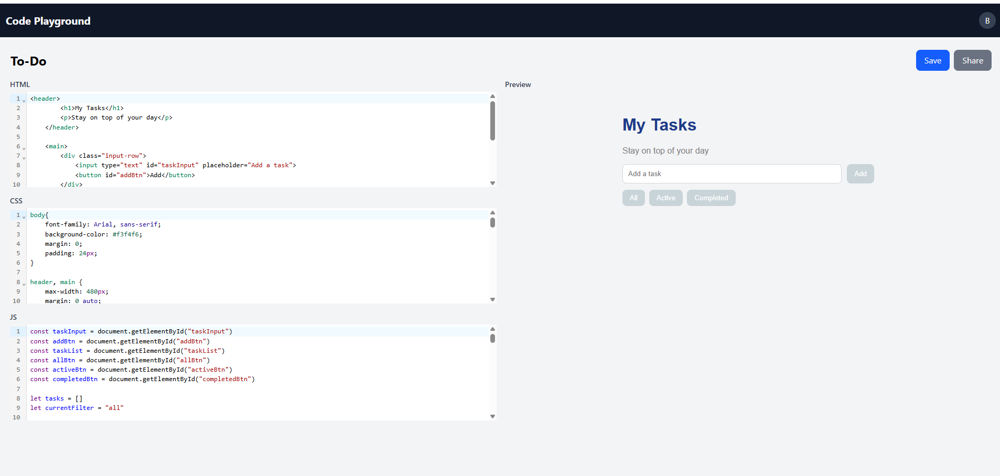

# Code Playground

A browser-based code editor where you write HTML, CSS and JavaScript and see a live preview as you type. You can save your projects, share them with a public link, and fork other people's work into your own account.

**Live demo:** https://code-playground-indol-sigma.vercel.app
**Demo project:** A To-Do app built inside Code playground https://code-playground-indol-sigma.vercel.app/share/6aeb38237d6a62dc974708dc


> The backend runs on Render's free plan, so the first request can take about 50 seconds while the server wakes up.



## Features

- Sign up and log in with JWT authentication; passwords are hashed with bcrypt
- Create, rename, save and delete projects
- Three code editors (HTML, CSS, JS) with syntax highlighting, using CodeMirror
- Live preview in a sandboxed iframe
- Share a project with a public link, copied straight to the clipboard
- Fork any shared project into your own account
- Only the owner can view, edit or delete their projects
- Search projects on the dashboard
- Responsive layout for phones, tablets and laptops

## Tech stack

**Frontend:** React, React Router, Tailwind CSS, CodeMirror, Vite
**Backend:** Node.js, Express, MongoDB with Mongoose, JWT, bcrypt
**Deployment:** Vercel (frontend), Render (backend), MongoDB Atlas (database)

## Run it locally

### 1. Clone the repo

```bash
git clone https://github.com/Himanshubehal/code-playground.git
cd Code-Playground
```

### 2. Backend

```bash
cd server
npm install
```

Create a `.env` file in `server`:

```
MONGO_URI=your_mongodb_connection_string
JWT_SECRET=any_long_random_string
```

Then start it:

```bash
npm run dev
```

### 3. Frontend

```bash
cd Client
npm install
```

Create a `.env` file in `Client`:

```
VITE_API_URL=http://localhost:5000
```

Then start it:

```bash
npm run dev
```

## API overview

| Method | Route | What it does |
| --- | --- | --- |
| POST | `/api/auth/register` | Create an account |
| POST | `/api/auth/login` | Log in |
| GET | `/api/auth/me` | Get the logged-in user |
| GET | `/api/projects` | List my projects |
| POST | `/api/projects` | Create a project |
| GET | `/api/projects/:id` | Get one of my projects |
| PUT | `/api/projects/:id` | Update a project |
| DELETE | `/api/projects/:id` | Delete a project |
| GET | `/api/projects/public/:id` | View a shared project (no login) |
| POST | `/api/projects/:id/fork` | Fork a project into my account |

## What I'd add next

- Autosave while typing
- Email verification and password reset